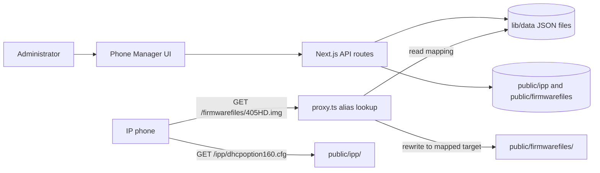

# Phone Manager Lite: How It Works

Phone Manager Lite is a small web app for managing IP phone provisioning files. The current implementation is aimed at AudioCodes phones. It stores configuration files and firmware under `public/`, keeps model aliases and firmware mappings as JSON files, and serves those public files over HTTP.

It is not backed by a database. The management UI and its API routes read and write files on the app's local filesystem.

## At a Glance



The management UI starts at `/phonemanager`. The site root `/` is currently an empty page. Navigation and the shared page layout are in [app/layout.tsx](app/layout.tsx).

## Main Parts

| Area | What it manages | Where the data lives |
| --- | --- | --- |
| Devices | Model filename aliases that phones may request | `lib/data/models.json` |
| Firmware | Firmware files organized into folders such as `sip/`, `teams/`, and `sipgateway/` | `public/firmwarefiles/` |
| Redirects | Maps a requested firmware alias to a real firmware file | `lib/data/redirects.json` |
| Configuration | `.cfg` provisioning files | `public/ipp/` |

The Devices list helps build the alias choices in the Redirects screen. The actual firmware rewrite uses `redirects.json`; adding a model alias alone does not create a mapping.

## Firmware Request Flow

1. Upload firmware into a folder under `public/firmwarefiles/`, for example `public/firmwarefiles/sip/phone.img`.
2. Add or select the filename the phone requests, such as `405HD.img`, in Devices.
3. In Redirects, map that alias to the uploaded file path, such as `sip/phone.img`.
4. The phone requests `/firmwarefiles/405HD.img`.
5. [proxy.ts](proxy.ts) looks up the exact requested alias in `lib/data/redirects.json`. If it finds a target, it internally rewrites the request to `/firmwarefiles/sip/phone.img`; the phone receives the target file without seeing a browser-style redirect.

If there is no mapping, the request continues normally. That means a real file at the requested path can still be served directly; otherwise the request will not resolve to the mapped firmware. Alias matching is exact, including letter case, so the alias must match what the phone requests.

The proxy only treats a single path segment after `/firmwarefiles/` as an alias. Nested paths such as `/firmwarefiles/sip/phone.img` are treated as direct file paths, not aliases.

## Configuration Request Flow

Configuration files are static files under `public/ipp/`. A phone can retrieve the default DHCP option 160 file at:

```text
http://<server-address>:3000/ipp/dhcpoption160.cfg
```

The file commonly points the phone at the provisioning and firmware URLs. The current sample file is [public/ipp/dhcpoption160.cfg](public/ipp/dhcpoption160.cfg). The Configuration Editor can list, read, create, update, and delete `.cfg` files. `dhcpoption160.cfg` is protected from deletion.

The app does not interpret or validate the contents of these configuration files; it stores text and serves it as a public file. Phone behavior depends on the settings and URLs written into the configuration.

## Screens and API Routes

| Screen | Page | API route | Purpose |
| --- | --- | --- | --- |
| Dashboard | [app/phonemanager/page.tsx](app/phonemanager/page.tsx) | `/api/phonemanager/config`, `/api/phonemanager/models`, `/api/phonemanager/redirects` | Shows counts and suggested setup steps |
| Devices | [app/phonemanager/devices/page.tsx](app/phonemanager/devices/page.tsx) | `/api/phonemanager/models` | Edits the model alias list |
| Firmware | [app/phonemanager/firmware/page.tsx](app/phonemanager/firmware/page.tsx) | `/api/phonemanager/firmware` | Lists folders/files, uploads, and deletes firmware |
| Redirects | [app/phonemanager/redirects/page.tsx](app/phonemanager/redirects/page.tsx) | `/api/phonemanager/redirects` | Maps aliases to firmware paths |
| Configuration | [app/phonemanager/configuration/page.tsx](app/phonemanager/configuration/page.tsx) | `/api/phonemanager/config` | Edits `.cfg` files |

The API handlers are in `app/api/phonemanager/`. The dashboard counts files and mappings; it does not perform provisioning itself.

## Setting It Up

1. Put firmware files under `public/firmwarefiles/`, in the appropriate vendor or product folder.
2. Make sure `public/ipp/dhcpoption160.cfg` exists and contains the URLs phones should use. The repository also includes `public/ipp/0000000.cfg`.
3. Add the filenames requested by the phones to Devices.
4. Create a Redirects mapping for each requested firmware filename and select its actual firmware target.
5. Configure DHCP option 160 or the phone's provisioning settings to point to the app's `/ipp/dhcpoption160.cfg` URL.
6. Test the configuration URL and a firmware alias URL from a client that can reach the app.

The README has the original setup examples and container commands: [README.md](README.md).

## Running and Deployment

For local development, the README describes installing dependencies and running `npm run dev`. The production image uses Next.js standalone output and starts on port `3000`; the container definitions are [Containerfile](Containerfile) and [compose.yml](compose.yml). Compose expects a `.env.production` file.

There are two filesystem details to account for before using the container for live management:

- The API writes changes into `public/` and `lib/data/`, but Compose does not define persistent volume mounts. Treat in-container changes as non-durable across container replacement unless you configure persistent storage.
- The Containerfile copies `public/` without changing its ownership, then runs the server as the non-root `nextjs` user. Since the API needs to write firmware and config files there, verify or adjust directory ownership/permissions (or provide writable mounts) before relying on uploads and edits in the container.

Also, the Containerfile runs `npm ci`, while the repository currently has `pnpm-lock.yaml` and no `package-lock.json`. The container build's package installation step may need to be aligned with the lockfile/package manager.

## Operational and Security Notes

- The management pages and API routes shown in this project do not implement authentication. Restrict network access or put an authenticated reverse proxy in front of the app before exposing it beyond a trusted network.
- Files under `public/` are intended to be directly retrievable by URL. Do not place secrets in phone configuration files or firmware directories.
- Yealink and Poly are mentioned as future support in the README; current model aliases and workflows are oriented around AudioCodes.
- Firmware redirect targets should be paths relative to `public/firmwarefiles/`, for example `teams/model-firmware.zip`, not full URLs.

## Useful Source Files

- [app/layout.tsx](app/layout.tsx): global navigation and layout
- [proxy.ts](proxy.ts): firmware alias lookup and rewrite
- [app/api/phonemanager/models/route.ts](app/api/phonemanager/models/route.ts): model JSON read/write
- [app/api/phonemanager/redirects/route.ts](app/api/phonemanager/redirects/route.ts): mapping JSON read/write and firmware target listing
- [app/api/phonemanager/firmware/route.ts](app/api/phonemanager/firmware/route.ts): firmware file operations
- [app/api/phonemanager/config/route.ts](app/api/phonemanager/config/route.ts): configuration file operations
- [lib/data/models.json](lib/data/models.json): initial model aliases
- [lib/data/redirects.json](lib/data/redirects.json): initial firmware mappings